<div align="center">

# dvklab

### 70 landing-page heroes that actually move.

Real WebGL shaders, scroll-driven worlds and ASCII simulations. Free, and one paste to ship.

**[Live gallery →](https://dvklab.vercel.app)** · **[⭐ Star on GitHub](https://github.com/diiviikk5/Hacktemplates)**

<a href="https://dvklab.vercel.app/templates/vermilion/">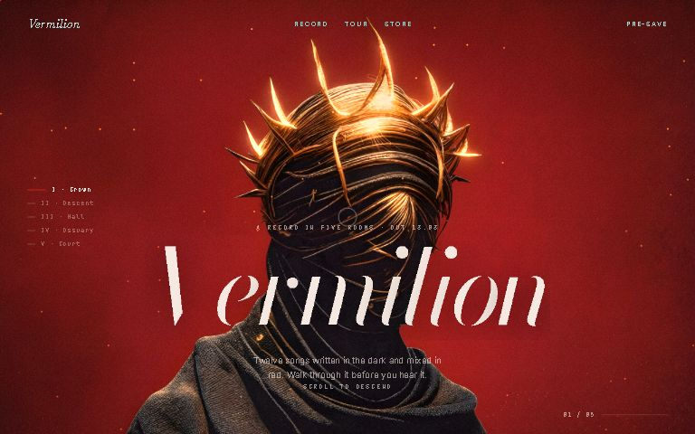</a>
<a href="https://dvklab.vercel.app/templates/ashborne/">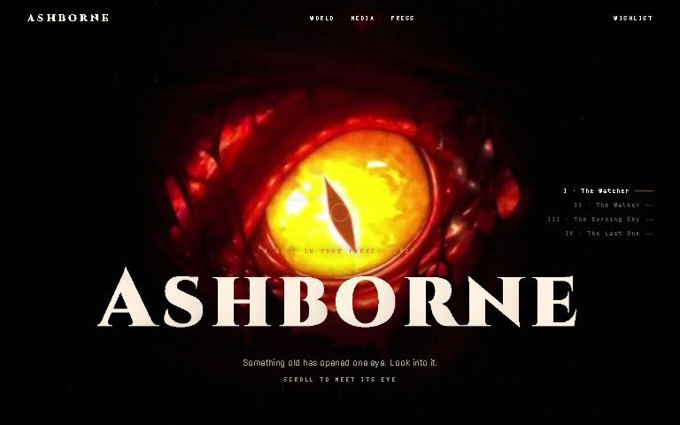</a>
<a href="https://dvklab.vercel.app/templates/currents/">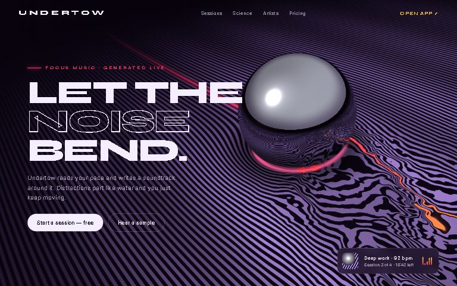</a>

</div>

---

## Why

At a hackathon, the landing page is the first thing judges see and the last thing you have time for.
dvklab is a shelf of finished, moving hero sections: pick one, copy it, change the words, ship.

- **No build, no install.** Each hero is one HTML file plus one `bg.js`. No npm, no framework, no signup.
- **Actually animated.** Not looping videos: shaders run live, react to the cursor, and stay sharp at any size.
- **Two ways to take it.** The full hero with type, nav and CTAs, or just the motion background behind your own content.
- **Made to be used.** Pauses off-screen, respects `prefers-reduced-motion`, falls back to a CSS gradient without WebGL.

## Quick start

**1. Grab a full hero.** Open the [gallery](https://dvklab.vercel.app), hover a card to see it move, hit **Copy hero**, paste into `index.html`. Done: assets load from the hosted copy.

**2. Or just the background**, behind anything you already have:

```html
<section style="position:relative; min-height:100vh; isolation:isolate">
  <canvas data-bg style="position:absolute; inset:0; width:100%; height:100%; z-index:-1"></canvas>
  <!-- your content -->
</section>
<script src="https://dvklab.vercel.app/templates/mercury/bg.js"></script>
```

Swap `mercury` for any template's folder name. No `<canvas data-bg>` on the page? `bg.js` makes a fixed full-screen one.

**3. Or clone it** and own everything:

```bash
git clone https://github.com/diiviikk5/Hacktemplates && cd Hacktemplates
python -m http.server 5173   # image templates need http://, browsers block textures from file://
```

## What's inside

| Family | What it is | Try |
| --- | --- | --- |
| **Experiences** | Multi-room scroll stories: Lenis + GSAP ScrollTrigger drive one WebGL scene, with camera dives between rooms | [Vermilion](https://dvklab.vercel.app/templates/vermilion/) · [Ashborne](https://dvklab.vercel.app/templates/ashborne/) |
| **Shaders & 3D** | Ray-marched and ray-traced scenes, fully procedural: black hole, liquid chrome, ocean, clouds, glass | [Event Horizon](https://dvklab.vercel.app/templates/event-horizon/) · [Mercury](https://dvklab.vercel.app/templates/mercury/) · [Currents](https://dvklab.vercel.app/templates/currents/) |
| **Living artwork** | Illustrations brought to life: depth parallax, rigged wings, flowing fire, wind, weather | [Desert Dragon](https://dvklab.vercel.app/templates/desert-dragon/) · [Starmind](https://dvklab.vercel.app/templates/starmind/) · [Respite](https://dvklab.vercel.app/templates/respite/) |
| **ASCII & print** | Live 3D and simulations rendered as glyphs or halftone dots | [Orbit ASCII](https://dvklab.vercel.app/templates/orbit-ascii/) · [Vapor](https://dvklab.vercel.app/templates/vapor/) · [Halftone](https://dvklab.vercel.app/templates/halftone/) |
| **Gradients & glass** | Grain gradients, reeded glass, silk folds, fire through fluted glass | [Fold](https://dvklab.vercel.app/templates/fold/) · [Furnace](https://dvklab.vercel.app/templates/furnace/) · [Fluted](https://dvklab.vercel.app/templates/fluted/) |

Every hero comes dressed for a real product (AI tools, dev tools, games, studios, events, travel), so you start from a page that already reads well.

## Featured

<table>
<tr>
<td><a href="https://dvklab.vercel.app/templates/relic/">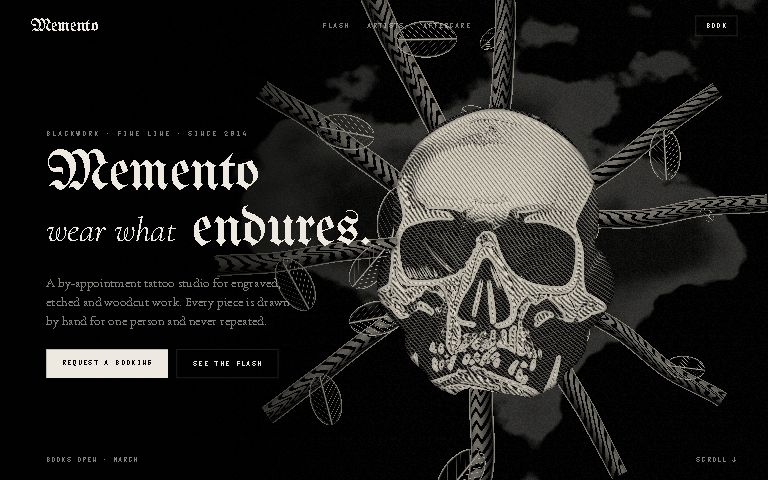</a><br><b>Relic</b>: an engraved skull that builds itself from shards</td>
<td><a href="https://dvklab.vercel.app/templates/ronin/">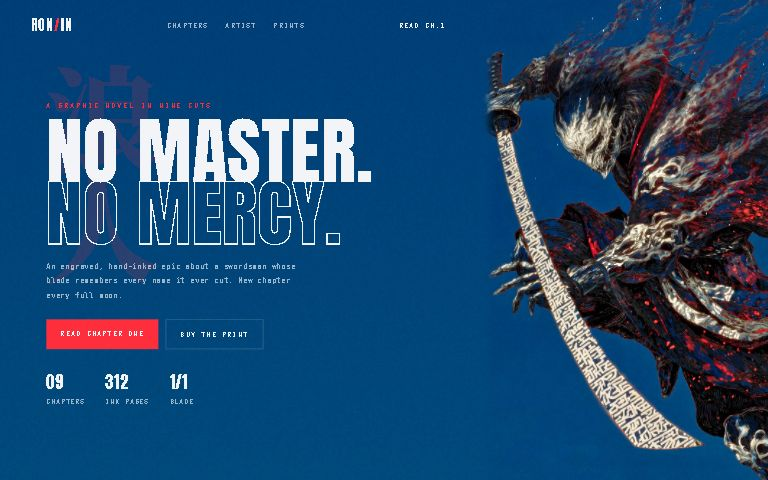</a><br><b>Ronin</b>: wisps stream, light runs down the blade</td>
<td><a href="https://dvklab.vercel.app/templates/signal/">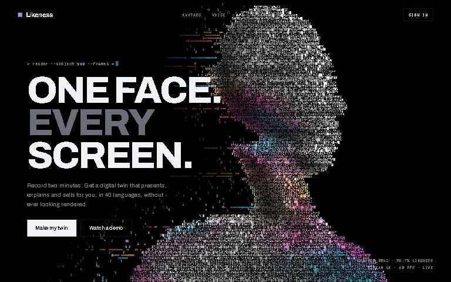</a><br><b>Signal</b>: a glitching portrait made of live glyphs</td>
</tr>
<tr>
<td><a href="https://dvklab.vercel.app/templates/event-horizon/">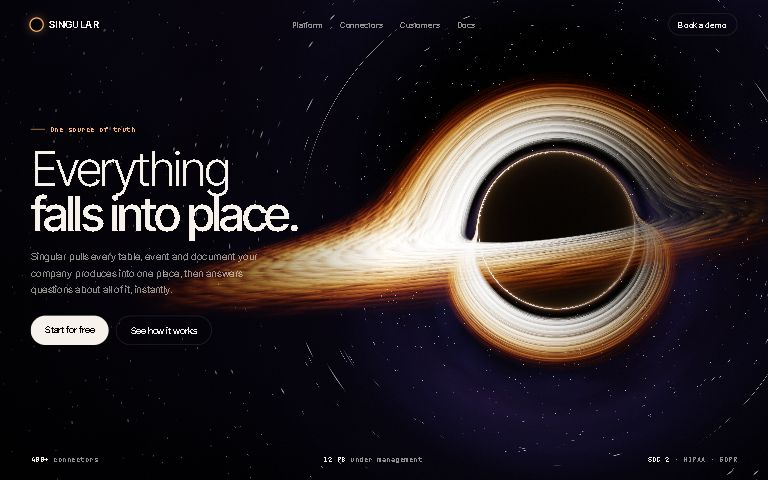</a><br><b>Event Horizon</b>: a ray-traced black hole bending light</td>
<td><a href="https://dvklab.vercel.app/templates/fold/">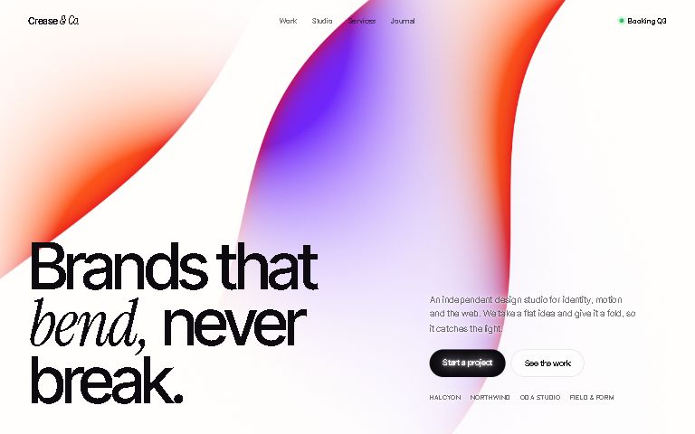</a><br><b>Fold</b>: dyed silk creases travelling across paper</td>
<td><a href="https://dvklab.vercel.app/templates/orbit-ascii/">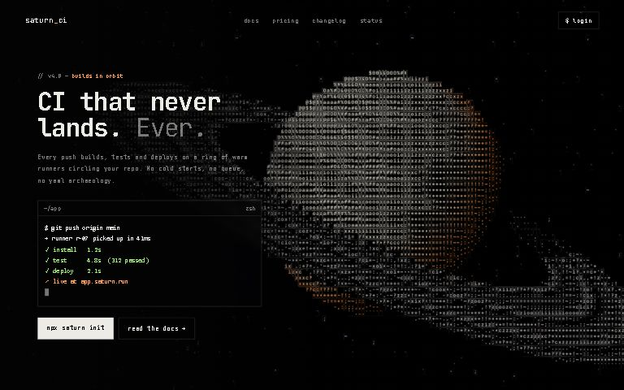</a><br><b>Orbit ASCII</b>: a ringed planet drawn in characters</td>
</tr>
<tr>
<td><a href="https://dvklab.vercel.app/templates/sentinel/">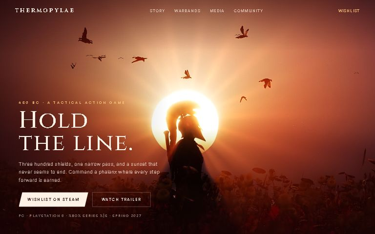</a><br><b>Sentinel</b>: rays turn behind a lone warrior</td>
<td><a href="https://dvklab.vercel.app/templates/vapor/">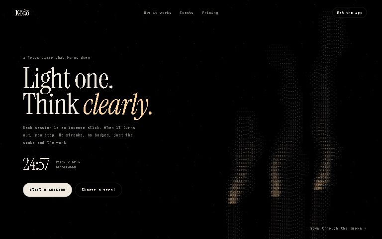</a><br><b>Vapor</b>: incense smoke you can stir with the cursor</td>
<td><a href="https://dvklab.vercel.app/templates/mercury/">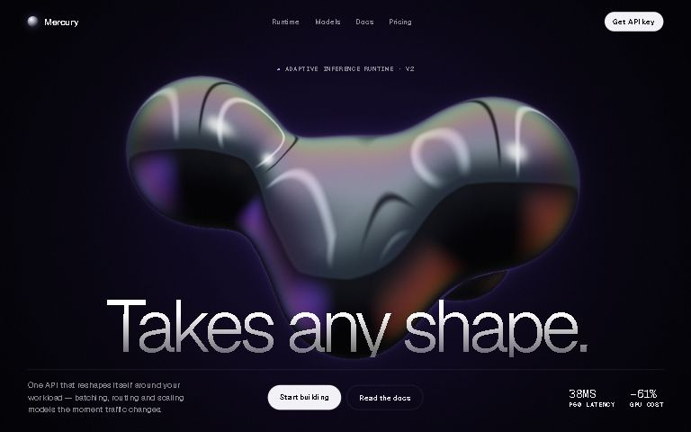</a><br><b>Mercury</b>: liquid chrome that takes any shape</td>
</tr>
</table>

**[See all 70 →](https://dvklab.vercel.app)**

## Under the hood

Each template is a folder in `templates/<slug>/`:

| File | Purpose |
| --- | --- |
| `index.html` | The full hero: nav, headline, CTAs, entrance motion |
| `bg.html` | The motion background on its own |
| `bg.js` | The background: one self-contained WebGL program that mounts on `canvas[data-bg]` |
| `scene.jpg`, `maps.png`… | Image templates only: the artwork (AI-upscaled) and its depth map |

Handy options, all optional:

```html
<canvas data-bg data-focus=".3,.6"></canvas>   <!-- image templates: which part of the picture stays in view when cropped -->
<canvas data-bg data-cell="10"></canvas>       <!-- ASCII templates: character size in px -->
<canvas data-bg data-room="2"></canvas>        <!-- experiences: hold one room instead of auto-playing -->
```

- **Performance:** rendering pauses when the canvas is off-screen; append `?preview` to any page for a lighter, half-resolution render.
- **Accessibility:** `prefers-reduced-motion` gets a still frame and no entrance animation.
- **Fallbacks:** no WebGL means a matching CSS gradient instead of a blank box.
- **Dependencies:** none, except the two scroll experiences, which load GSAP, ScrollTrigger and Lenis from a CDN.

Works in current Chrome, Edge, Firefox and Safari (WebGL2 for most templates).

## License

The code (HTML, CSS, JS, GLSL) is [MIT](LICENSE): use it in anything, commercial included. The MIT license covers the code only; the reference artwork in image templates isn't ours to license (see below).

## Credits

- Fonts from Google Fonts. The ASCII glyph atlas uses JetBrains Mono (SIL Open Font License).
- The scroll experiences use [GSAP](https://gsap.com) and [Lenis](https://lenis.darkroom.engineering).
- Image templates animate reference artwork collected while building. Credit where known: Starmind's poster is by Dogan Ural, and Currents is a shader rebuild of the look of Robert Beatty's *Currents* cover. **Before using an image template commercially, swap in artwork you have the rights to:** drop your own `scene.jpg` in.

## Roadmap

- [ ] Orbit (astronaut over Earth), Nightwalk, Commute, Phantom
- [ ] Glacier, waiting on a licensed ice photo
- [ ] More ASCII scenes and scroll experiences

Have a reference you want brought to life? [Open an issue](https://github.com/diiviikk5/Hacktemplates/issues).

---

<details>
<summary><b>Build log</b>: every reference and what it became</summary>


- [x] Aurora Horizon — teal/coral drifting horizon
- [x] Ultraviolet — grainy violet diagonal band
- [x] Eclipse — dark disc, bone halo, orbit rings
- [x] Ember — warm-to-ice flowing gradient, event hero
- [x] Bokeh — drifting light blobs, AI prompt hero
- [x] Prism — neon RGB swirl, agency hero
- [x] Nimbus — wind-blown clouds, devtool hero
- [x] Daybreak — sunrise dome, waitlist hero
- [x] Abyss — underwater ripples, data hero
- [x] Dusk — evening sky, portfolio hero
- [ ] Orbit — astronaut over Earth
- [ ] Nightwalk — stars, billowing clouds, lone walker
- [ ] Commute — anime train window, passing fields
- [ ] Phantom — red face dissolving into particles
- [x] Grotto — cave waterfall, light shafts
- [x] Meadow — handheld console in a flower field
- [x] Pocket — 3D retro handheld
- [x] Ukiyo — pagoda light pillars, water reflection
- [x] Aura — soft orange orb, light theme
- [x] Solstice — giant sun, tiny figure
- [x] Beam — red light beam, lone figure
- [x] Fluted — reeded glass refraction
- [x] Glitch — chromatic visor glitch
- [x] Ruins — fantasy ruins above the clouds
- [x] Red Dragon — fire dragon
- [x] Desert Dragon — dragon against the sun
- [x] Ink Dragon — ink-wash dragon
- [x] Smoke Dragon — dragon dissolving into smoke
- [x] Pixel Sword — pixel-art sword in the forest
- [x] Ash King — crowned king, storm sky
- [x] Redwood — sunlit redwoods, drifting mist (D1)
- [x] Silk — sculpted white ribbon, orange glow (D2)
- [x] Stratosphere — night blue to dawn horizon (D3)
- [x] Spectrum — rainbow wash, smoked glass waves (D4)
- [x] Thermal — flowing heat bands (D5)
- [x] Canyon Violet — layered violet ridges (D6)
- [ ] Glacier — cracked blue ice (D7) — source is a watermarked stock preview; needs a free/licensed ice photo
- [x] Fuji — mountain, cloud band, night lake (D8)
- [x] Canyon Magenta — layered magenta ridges (D9)
- [x] Static — grainy orange/teal gradient (D10)
- [x] Tidewave — bold red/blue/gold waves (D11)
- [x] Reed Rose — pink/lavender reeded glass (D12)
- [x] Reed Crimson — red reeded glass (D13)
- [x] Sandstorm — swept amber smoke (D14)
- [x] Reed Ember — orange band behind reeded glass (D15)
- [x] Riptide — grainy navy wave (D16)
- [x] Canyon Blue — layered blue ridges (D17)
- [x] Evergreen — misty pine forest (D18)
- [x] Twilight — violet to peach sky (D19)
- [x] Reed Spectrum — teal/red/orange reeded glass (D20)
- [x] Reed Flame — red/orange crossing light, reeded (D21)
- [x] Sunset Ridge — orange sun behind dark peaks (D22)
- [x] Aurora — northern lights over a mirror lake (D23)
- [x] Stipple — dithered neon hills (D24)

### Batch 3 — full-motion heroes (each built to its own effect)
- [x] Currents — chrome sphere in op-art streamlines (real potential flow, ray-traced reflections; after Robert Beatty's cover for Tame Impala)
- [x] Furnace — molten fluted bars (orange light through reeded glass)
- [x] Starmind — hand in a beam of dust (poster by Dogan Ural)
- [x] Signal — glitch-glyph portrait (style ref: "One Flair Design", watermarked AI image, so the effect is rebuilt, not the image)
- [x] Savanna — acacia sunset illustration
- [x] Sentinel — spartan against the sun, poppy field
- [x] Fold — orange/violet silk folds on white (from the motion clip)

### Batch 4 — experiences (scroll-driven, GSAP + Lenis + WebGL)
- [x] Vermilion — five red rooms in one scroll: crown, vortex, colonnade, ossuary, court (the red city reference is skipped: PIXELSTALK.NET watermark)
- [x] Relic — engraved skull assembling from shards (motion from the skull video, whose frames carry a creator watermark; the skull is cut from the red skulls image)

### Batch 5 — ASCII family + Ember experience
- [x] Orbit ASCII — ray-traced ringed planet drawn in glyphs (ASCII engine: scene → cell buffer → JetBrains Mono atlas, OFL)
- [x] Halftone — colour dot-screen landscapes cutting through palettes (after the halftone mountains video, which has no watermark)
- [x] Vapor — stir-able ASCII smoke simulation
- [x] Ashborne — scroll experience: dragon eye (video) → into the pupil → fire walker → burning clouds → the wanderer
- [x] Ronin — blue samurai, flames and blade alive
- [x] Respite — knight resting under the tree

</details>

<div align="center"><sub>Built for hackers who ship on Sunday morning. If it saved you an hour, <a href="https://github.com/diiviikk5/Hacktemplates">leave a star</a>.</sub></div>
